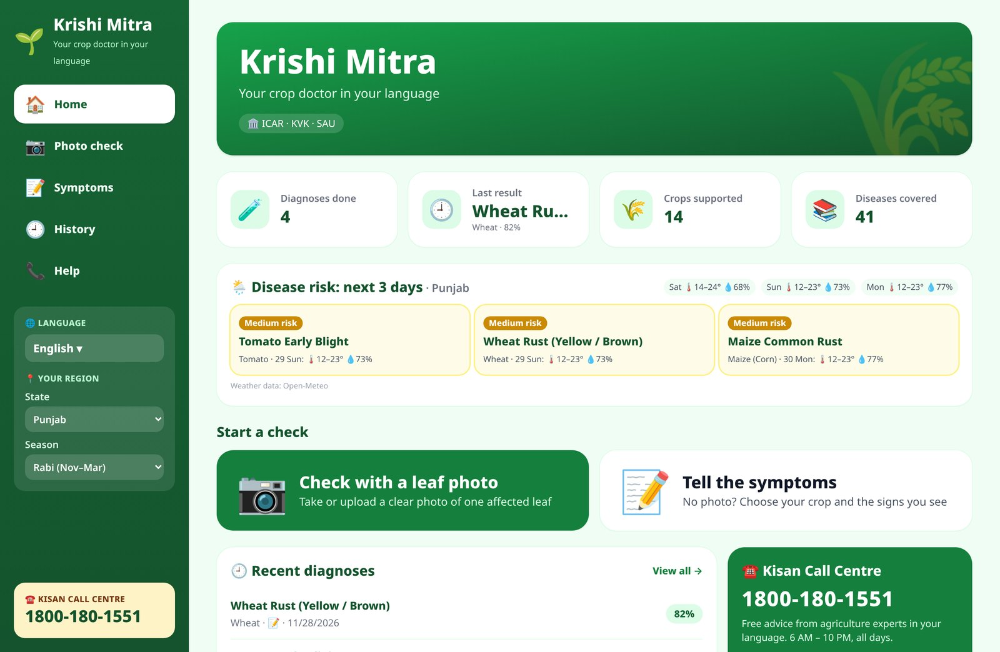
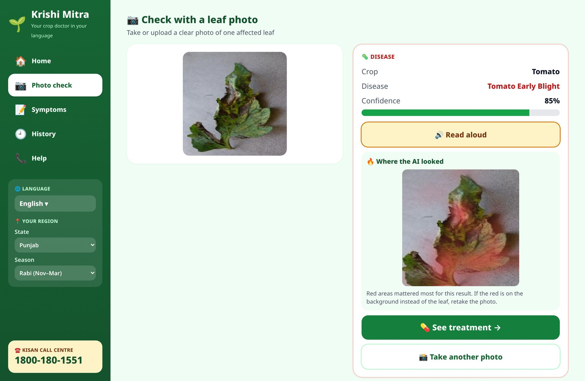
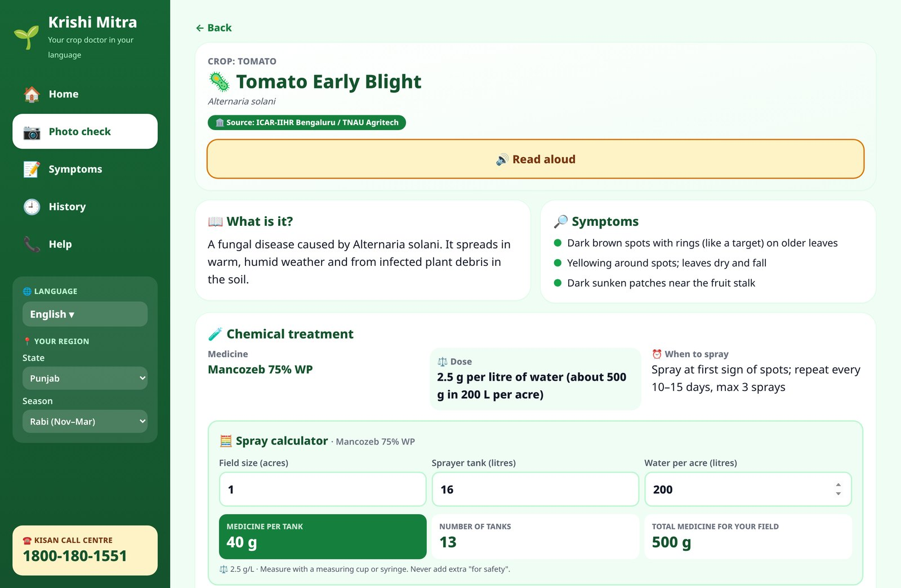
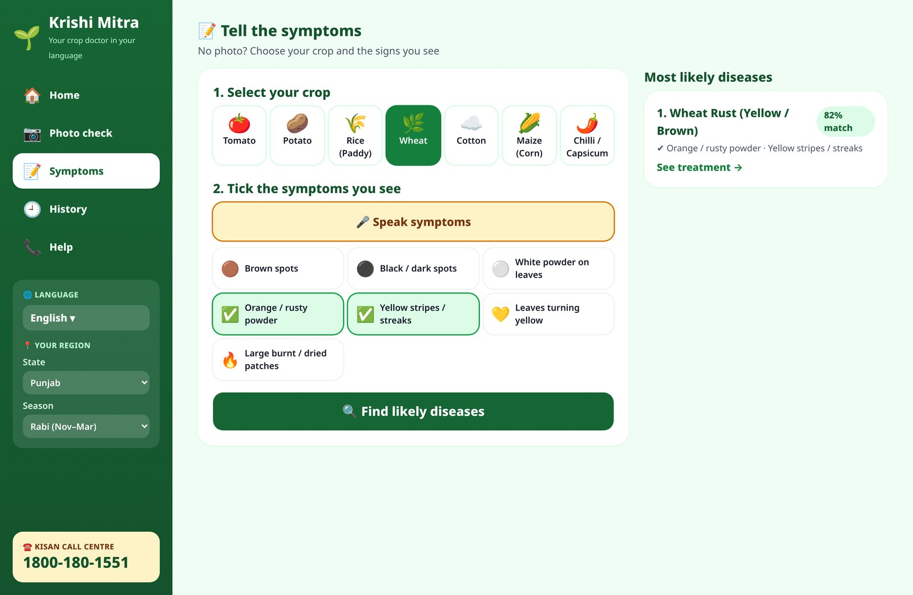
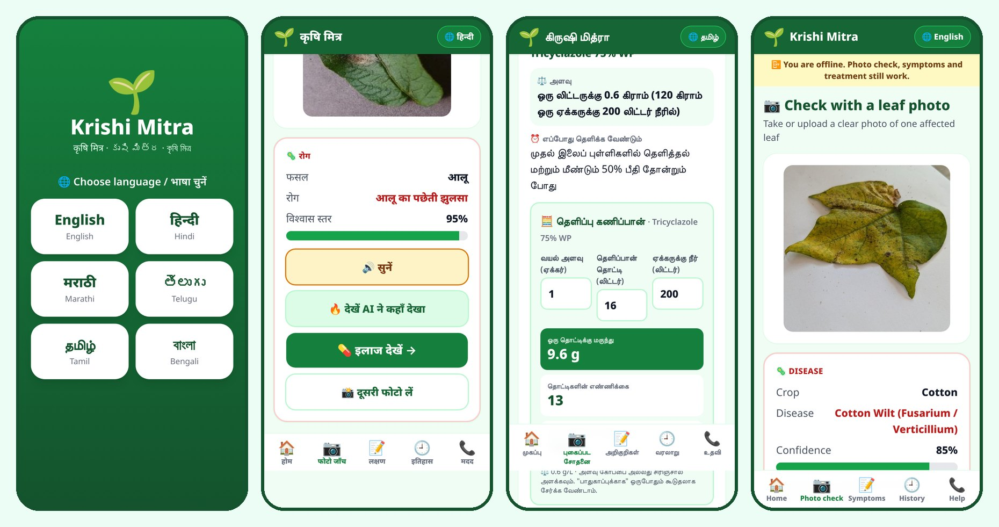

# 🌱 Krishi Mitra – कृषि मित्र

**A multilingual crop disease diagnosis and treatment assistant for Indian farmers.**

🌐 **Live demo: [krishi-mitra-ol3d.netlify.app](https://krishi-mitra-ol3d.netlify.app)** · 📊 **Pitch deck: [PowerPoint](docs/pitch/Krishi_Mitra_Avishkaar_S4.pptx) / [PDF](docs/pitch/Krishi_Mitra_Avishkaar_S4.pdf)** (Team Codebreaker, Avishkaar Season 4). It works on phones too, with no install or sign-up, and keeps working offline after the first visit.



Farmers often can't identify crop diseases with confidence. They depend on neighbours or pesticide sellers, which leads to inconsistent advice and pesticide misuse. Most information is also not in their language or specific to their region. Krishi Mitra identifies the disease from a **leaf photo** or from **symptoms (tapped or spoken)**. It then gives **crop-specific, region-aware treatment advice in the farmer's language**, read aloud if needed, and every recommendation cites ICAR / State Agricultural University guidelines.

## 🏆 Why Krishi Mitra stands out

- **Works without internet.** The AI model runs on the phone itself, so diagnosis works in the field with no signal after the first visit.
- **Trained for real farm photos, not just lab images.** We fine-tuned the model on real field photos: accuracy on them rose from **31% to 67%**, and rice, wheat and cotton were added (**89%** on held-out photos).
- **Explainable AI.** A heatmap shows *where on the leaf* the AI looked, so farmers and experts can trust or question the result.
- **Prevents pesticide misuse.** Exact dose per litre and per acre, a **spray calculator** for the farmer's own tank and field, and warnings against overuse and tank-mixing.
- **Warns before the disease appears.** A 3-day weather forecast for the farmer's state is checked against the conditions each disease favours.
- **6 Indian languages with voice:** speak the symptoms, and hear the advice read aloud.
- **Honest about uncertainty.** Low-confidence results are labelled "possible disease" or trigger a retake, and non-leaf photos are rejected.
- **100% free to run.** No paid APIs, keys or servers: a static site on Netlify, free Open-Meteo weather and open-source models. (The optional Python backend can use a paid vision LLM as a fallback, but only if you add your own key; the live app never does.)

## 📸 Screenshots

| Photo diagnosis with "Where the AI looked" heatmap | Treatment page with spray calculator |
|---|---|
|  |  |

**Symptom check (no photo needed):** pick the crop, tap or speak the symptoms, and get the top 3 likely diseases.



**On a phone:** language picker → Hindi photo result → Tamil treatment with spray calculator → still working **offline**.



## ✨ Features

| | Feature |
|---|---|
| 🌐 | **6 languages**: English, हिन्दी, मराठी, తెలుగు, தமிழ், বাংলা. The whole UI switches language. |
| 📷 | **Image diagnosis**: take a photo with the camera or upload one. Shows the crop, disease, confidence % and a "healthy" result. Below 60% confidence it asks for a retake. |
| 🌱 | **"Which crop is this?" selector** (optional): with the crop chosen, only that crop's diseases are ranked. On real field photos accuracy rises from **69% to 82%**, rice can never come out as maize, and a photo that doesn't look like the chosen crop is flagged. A guide on the photo page asks for one leaf, close-up, not grains, fruit or the whole field. |
| 📝 | **Symptom diagnosis**: pick a crop, tick symptoms (icon tiles) **or speak them** (Web Speech API). Returns the top 3 likely diseases. |
| 💊 | **Treatment**: simple explanation and cause, chemical product, **dose per litre and per acre**, spray timing, safety precautions, organic / low-cost alternative, prevention, and a warning against overuse and tank-mixing. Each one is tagged with its source. |
| 📍 | **Region & season awareness**: choose a state and season (Kharif / Rabi / Zaid) to get region-specific tips. |
| 🔊 | **Read aloud** (text-to-speech) on every result, in the selected language. |
| 🕘 | **History** of past diagnoses, stored in localStorage. |
| 📴 | **Works offline**: an installable app (PWA). After the first visit, photo diagnosis, symptoms and treatment all work without internet, because the model runs on the phone. |
| 🧮 | **Spray calculator**: enter field size and sprayer tank size to get the exact medicine per tank, number of tanks and total quantity, to prevent over-spraying. |
| 🌦️ | **Weather-based disease risk**: a 3-day forecast for your state (free [Open-Meteo](https://open-meteo.com) API, no key) is checked against the weather each disease favours, to warn *before* the disease appears. |
| 🔥 | **"Where the AI looked" heatmap**: occlusion-sensitivity explainability, computed in the browser, shows which part of the leaf drove the diagnosis. |
| 📞 | **Help**: Kisan Call Centre **1800-180-1551** (tap to call) and a Krishi Vigyan Kendra note. |

## 🧠 How it works

- **Disease detection:** one small MobileNetV2 model (9 MB, **55 classes**) runs in the browser. It covers the 38 PlantVillage classes, plus **rice** (bacterial leaf blight, blast, brown spot, tungro, hispa, **false smut** on the grains, healthy), **wheat** (yellow rust, brown rust, septoria, healthy), **cotton** (bacterial blight, Alternaria leaf spot, Fusarium wilt, Verticillium wilt, healthy) and a **"Not a Plant Leaf"** class for unrelated photos. It started from [`linkanjarad/mobilenet_v2_1.0_224-plant-disease-identification`](https://huggingface.co/linkanjarad/mobilenet_v2_1.0_224-plant-disease-identification) and was trained in two stages:
  1. `backend/scripts/finetune_fieldphotos.py`: real field photos ([PlantDoc](https://huggingface.co/datasets/agyaatcoder/PlantDoc)), because the base model only knew lab photos.
  2. `backend/scripts/add_crops.py`: adds rice, wheat and cotton from [rice (India)](https://huggingface.co/datasets/Project-AgML/rice_leaf_disease_classification_india), [cotton](https://huggingface.co/datasets/Project-AgML/cotton_leaf_disease_classification) and [CropLeafDiseases](https://huggingface.co/datasets/wambugu71/CropLeafDiseases) (wheat, rice, non-leaf photos).
  3. `backend/scripts/add_false_smut.py`: adds rice false smut (a grain disease) from 50 field photos in [minhhungg/rice-disease-dataset](https://huggingface.co/datasets/minhhungg/rice-disease-dataset), with 10 held out for testing. Choosing **Rice** in "Which crop is this?" gives the most reliable result for grain photos.

  Weights are in `backend/models/krishi-mobilenetv2-field` (with `training_report.json`). Each prediction averages 3 views of the photo. If the model can't be loaded, the backend falls back to a vision LLM (Claude) when `ANTHROPIC_API_KEY` is set.

  | Measured on held-out photos | Base model | Krishi Mitra model |
  |---|---|---|
  | Field photos (PlantDoc test, 236): correct disease | 31% | **67%** (**82%** with the crop chosen) |
  | Field photos: correct crop | 51% | **82%** |
  | Lab photos (PlantVillage held-out) | 94% | **95%** |
  | Rice / wheat / cotton test photos (1,281): correct disease | n/a | **89%** |
  | Rice / wheat / cotton: correct crop | n/a | **99%** |
  | Rice false smut (10 held-out field photos) | n/a | **10/10** |

  **Known weak spots:** rice hispa is often mistaken for healthy rice (36%), because the scraping damage is tiny in its training photos. Cotton bacterial blight is 65%. Rice/wheat/cotton test photos come from the same sources as their training photos, so real-world accuracy will be lower than 89%. Cotton leaf curl virus has no photo dataset, so use the symptom checker for it. Results between 35% and 60% confidence are shown as "possible disease"; below 35%, or for non-leaf photos, the app asks for a retake.
- **Knowledge base:** `backend/data/diseases.json` holds **43 diseases + a healthy entry** (including rice grain diseases: false smut, grain discolouration, neck blast) across tomato, potato, rice, wheat, cotton, maize and chilli, plus the PlantVillage fruit crops. Every disease has full **English, Hindi and Marathi** content. All 54 model classes map to an entry (`class_map.json`). The JSON is generated from `backend/scripts/build_kb.py`.
- **Translation:** the UI is hand-translated into all 6 languages. Disease advice is hand-written in English, Hindi and Marathi. Telugu, Tamil and Bengali advice is machine-translated with Meta's open [NLLB-200](https://huggingface.co/facebook/nllb-200-distilled-600M) model, running locally for free (`backend/scripts/translate_kb.py`). Those pages say they are auto-translated and keep the English disease name alongside; any sentence where a number was dropped, added or repeated stays in English, so doses are never garbled. A native-speaker review is still recommended.
- **Symptom matching:** cosine similarity between the selected or spoken symptoms and each disease's symptom tags. Voice text is matched against keywords in 6 languages.

## 🛠️ Tech stack

React 18 + Vite + Tailwind CSS (responsive dashboard, mobile-first) · ONNX Runtime Web (in-browser AI) · PWA / service worker (offline) · Python FastAPI · 🤗 Transformers + PyTorch (training, optional backend) · Meta NLLB-200 (offline translation) · Open-Meteo (free weather) · Web Speech API · JSON knowledge base (no database)

## 🚀 Setup

Requires Python 3.10+ and Node 18+.

**Backend** (http://localhost:8000; the model, about 9 MB, downloads on first run):

```bash
cd backend && python -m venv .venv && . .venv/bin/activate && pip install torch --index-url https://download.pytorch.org/whl/cpu && pip install -r requirements.txt && cp -n .env.example .env; uvicorn app.main:app --reload --port 8000
```

**Frontend** (http://localhost:5173):

```bash
cd frontend && npm install && npm run dev
```

On Windows, activate the venv with `.venv\Scripts\activate` instead of `. .venv/bin/activate`.

By default the frontend runs **fully in the browser**: the model is exported to ONNX (`backend/scripts/export_onnx.py` → `frontend/src/model/`, bundled with content-hashed file names so browsers never use a stale model) and runs with ONNX Runtime Web, and symptom matching and knowledge-base lookup happen in JS (`frontend/src/local.js`). No backend is needed. To use the FastAPI backend instead, run `npm run dev:server`, or set `VITE_API_MODE=server`.

**Single-port demo:** run `VITE_API_MODE=server npm run build` in `frontend/`. The backend then serves the built app at http://localhost:8000.

## ☁️ Deploy (Netlify)

The app is live at **https://krishi-mitra-ol3d.netlify.app**. The repo is connected to Netlify, so every push to `main` deploys automatically, and pull requests get a preview link.

`netlify.toml` builds `frontend/` as a static site, with the in-browser model and no server. To deploy your own copy, connect the repo in Netlify, or run `netlify deploy --build --prod` from the repo root.

> Camera capture and voice input need HTTPS or `localhost`. For phone testing, use a tunnel such as `ngrok http 5173`.

## 🔌 API

| Method | Endpoint | Description |
|---|---|---|
| POST | `/api/predict?lang=hi` | multipart `file` → `{crop, crop_name, disease, disease_id, confidence, is_healthy, low_confidence, alternatives}` |
| POST | `/api/symptoms` | `{crop, symptoms[], text?, lang}` → top 3 matches |
| GET | `/api/disease/{id}?lang=hi&state=Punjab&season=rabi` | Full recommendation in the requested language |
| GET | `/api/crops?lang=hi` · `/api/symptom-list?lang=hi&crop=rice` · `/api/languages` · `/api/health` | Lookups |

Interactive docs are at http://localhost:8000/docs.

## 🖼️ Demo samples

`samples/` holds real leaf images: tomato early blight, potato late blight, tomato leaf curl virus, maize common rust, healthy tomato, rice blast, wheat yellow rust and cotton wilt. The Photo screen also offers them as one-tap samples.

## 📁 Structure

```
backend/   app/ (main.py, classifier.py, translate.py)
           data/ (diseases.json, class_map.json, crops.json, symptoms.json, kb_auto_translations.json)
           models/krishi-mobilenetv2-field/ (fine-tuned weights + training_report.json)
           scripts/ (build_kb.py, translate_kb.py, finetune_fieldphotos.py, add_crops.py, export_onnx.py)
frontend/  src/ (App.jsx, local.js, weather.js, pages/, components/, i18n/strings.js, model/)
samples/   demo leaf images
docs/      screenshots/
```

## ⚠️ Disclaimer

Krishi Mitra gives guidance only. Always read the pesticide label and confirm with your local Krishi Vigyan Kendra or agriculture officer. Dosages follow commonly published ICAR / SAU recommendations and may vary by product formulation.
